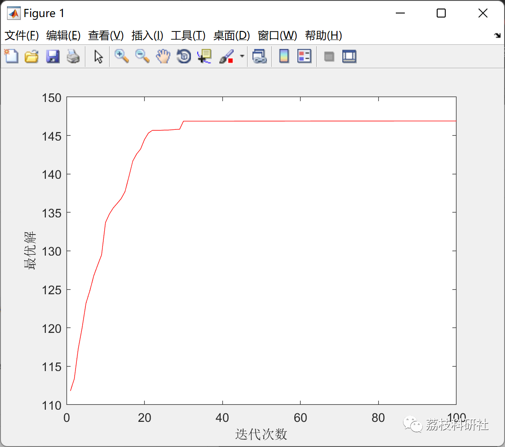
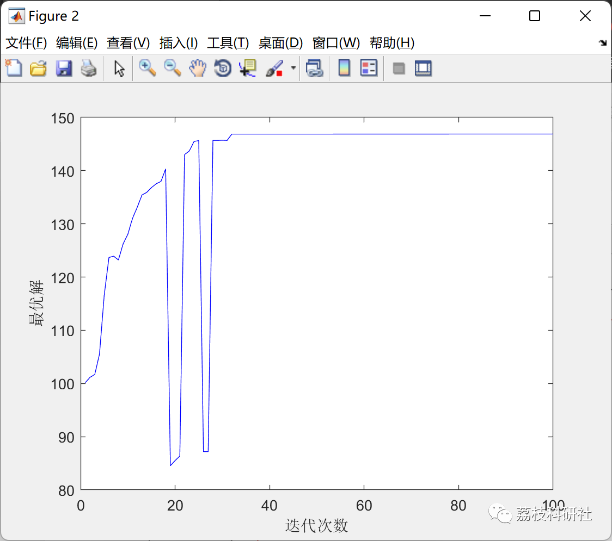

# Task Assignment Problem Based on Mixed VNS (Variable Neighborhood Search Algorithm) and PSO (Particle Swarm Optimization Algorithm) in Matlab

💥💥💞💞 Welcome to this blog❤️❤️💥💥
🏆 Bloggers' Advantages: 🌞🌞🌞 The content of the blog strives for rigorous thinking and clear logic to facilitate readers.
⛳️ Mantra: A journey of a thousand miles is begun with a single step.
Litchi Research Society
Code Collection: Power Systems, Intelligent Algorithms and Applications, Neural Network Prediction, Path Planning, Optimized Scheduling, Workshop Scheduling, Image Processing, Signal Processing...
🎁 Special Section Link: ​
🌈🌈🌈🌟🌟🌟 Electrical Code Drone and Physical Applications Path Planning Intelligent Algorithms and Their Applications Optimized Scheduling Neural Network Prediction Workshop Scheduling Image Processing Romantic Her Signal Processing Mathematical Modeling My Thoughts Voice Processing Complete Code Issues
💥1 Overview
The Particle Swarm Optimization (PSO) algorithm was first proposed by Kennedy and Eberhart; its basic principle is based on the simulation of bird flock hunting behavior. Currently, research on the continuous PSO algorithm focuses mainly on it, which describes the particle state and its movement rules as continuous. However, there is little research on discrete particle swarm optimization (DPSO). Only ClerC proposed an DPSO algorithm for solving TSP problems, but its performance still has a certain gap compared to other algorithms such as ant colony algorithms.
The assignment of independent tasks not only exists in computer parallel computing, operating systems, and other computer technology fields but also widely exists in industrial and agricultural production, transportation, and service industries. It usually aims to minimize the total completion time as the objective function, being a NP-hard combinatorial optimization problem, and does not have polynomial time complexity algorithms to find the global optimal solution. Although many heuristic algorithms have been attempted in the literature to obtain high-quality solutions, the quality of the solutions is still unsatisfactory. This paper proposes a hybrid VNS (Variable Neighborhood Search) PSO (Particle Swarm Optimization) algorithm to solve the task assignment problem in interception combat, a new algorithm that can effectively avoid particle swarms from getting stuck in local convergence and solve discrete optimization problems.
📚2 Running Results
The ultimate distribution matrix:
🎉3 References
[1] Zhong Yiwen, Yang Jianggang. Discrete Particle Swarm Optimization Algorithm for Independent Task Allocation Problem [J]. Pattern Recognition and Artificial Intelligence, 2006, 19(03): 399-405.
👨‍💻4 MATLAB Code Implementation
Click the left bottom corner of the article to read in full.

## Images

<!-- PAYMENT_BLOCK -->

## Get this dataset

- Payment link (Stripe): [Buy now](https://buy.stripe.com/3cs8yP7sY87d0vu9AB)
- Payment QR code: 

<!-- /PAYMENT_BLOCK -->
